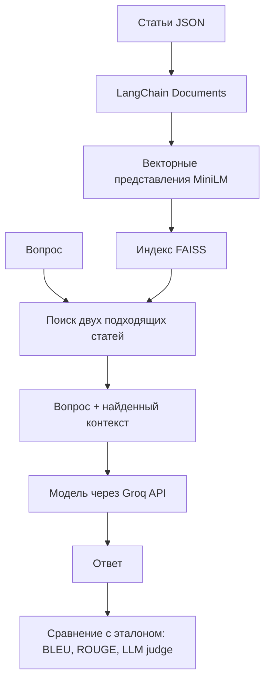

# Vanilla RAG: ответы по корпоративным документам

Учебный проект сравнивает ответы моделей без документов и с RAG — поиском
подходящих статей перед генерацией ответа. Основной код остаётся в ноутбуке:
его можно читать и выполнять по шагам.

## Структура проекта

```text
rag-practice/
├── notebooks/
│   └── RAG.ipynb              # эксперимент: от загрузки до оценки
├── data/
│   ├── raw/
│   │   └── articles.json      # 10 исходных статей
│   └── evaluation/
│       ├── questions.json    # 50 вопросов
│       └── ground_truth.json # 50 эталонных ответов
├── configs/
│   └── prompts.yaml          # промпт baseline Groq
├── reports/
│   └── experiment.md         # описание и результаты прежнего эксперимента
├── requirements.txt          # зависимости полного эксперимента
├── .env.example              # пример имени переменной с ключом
├── .gitignore
└── README.md
```

В `articles.json` запись содержит `id`, `title`, `text`. Вопросы содержат
`id`, `question`, а эталоны — `id`, `answer`. Вопрос и эталон соединяются по `id`.
Исходные данные не перезаписываются при выполнении ноутбука.

## Как работает RAG



Отдельно ноутбук проверяет ответы без контекста: Groq и Qwen через vLLM.
Это позволяет сравнить baseline с RAG. Короткая статья используется целиком,
без дополнительного разбиения. Индекс FAISS и ответы находятся в памяти;
автоматического сохранения новых результатов в файлы пока нет.

## Запуск

Полный эксперимент использует vLLM и явно выбирает `cuda` для embeddings.
Ориентируйтесь на среду с GPU, в которой запускался исходный ноутбук;
перенос файлов сам по себе не адаптирует вычисления к Windows или CPU.

1. Откройте всю папку проекта в VS Code или загрузите её целиком в рабочую среду.
2. В подготовленном Python-окружении установите зависимости из корня проекта:

   ```bash
   python -m pip install -r requirements.txt
   ```

3. Откройте `notebooks/RAG.ipynb`, выберите это окружение как kernel.
4. Выполняйте ячейки сверху вниз. Ключ Groq вводится через скрытое поле `getpass`.
   `.env.example` — только образец; текущий ноутбук автоматически `.env` не читает.
5. Для Colab сначала скопируйте проект с сохранением папок и переключите рабочую
   папку на корень проекта через `%cd /content/mentor/rag-practice`
   (путь зависит от того, куда вы поместили проект).

Первая ячейка с импортами ищет корень проекта от рабочей папки вверх.
Поэтому запуск работает из корня или `notebooks`, без жёсткого пути `/content`.
Выполнение полного эксперимента обращается к Groq и загружает модели.

## Назначение библиотек

| Библиотека | Зачем нужна |
|---|---|
| groq | Генерация ответов и оценка через API |
| vllm | Запуск локальной модели Qwen |
| langchain-core | Представление статей как Document |
| langchain-community, faiss-cpu | Векторный индекс и поиск |
| langchain-huggingface, sentence-transformers | Превращение текста в векторы |
| evaluate, sacrebleu, rouge-score | Метрики качества ответов |
| pandas | Работа с таблицами в ноутбуке |
| PyYAML | Чтение файла промптов |
| ipykernel | Запуск Python-ячеек ноутбука |

## Что учитывать при чтении результатов

[Подробный отчёт](reports/experiment.md) сохранён из предыдущей версии проекта.
Его числа относятся к прежнему запуску, а не к проверке новой структуры папок.
Повторный запуск может дать другие ответы и оценки.

В YAML сейчас вынесен промпт `ask_groq`; промпты judge, Qwen и RAG пока остаются
в ноутбуке. Ключ `summarize` в YAML в этом эксперименте не используется.
Соответствие вопросов нужным статьям в `get_expected_article_id` задано для
текущего набора из 50 вопросов: при замене данных его нужно пересмотреть.
